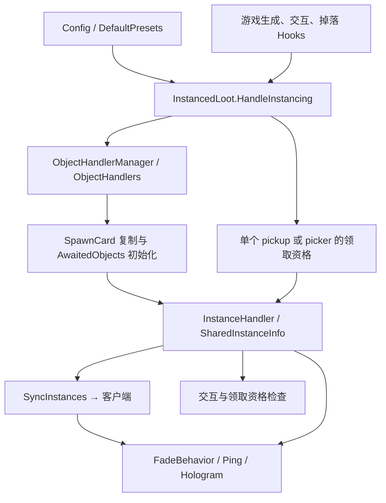

# 架构与数据流

## 系统模型

本项目通过 BepInEx 加载，用 `On.RoR2.*` 和 `IL.RoR2.*` 钩子接入游戏运行时。没有自有场景、服务器进程或持久化数据库；持久配置由 BepInEx 管理，局内状态主要挂在 Unity GameObject 上。



`InstanceMode` 表达“用户希望怎样分配”；`ObjectInstanceMode` 表达“这个对象怎样实现”。前者的 `InstanceItems` 不意味着复制多个可见模型，而通常意味着一个拾取对象服务多个玩家，各有一次领取资格。

## 插件生命周期

源码入口：[InstancedLoot.cs](../InstancedLoot/InstancedLoot.cs)。

1. `Awake`：创建 `Config`、`HookManager`、`ObjectHandlerManager`；ObjectHandler 的 `Init` 可向 HookManager 补充专用钩子；注册 `SyncInstances` 消息类型。
2. `OnEnable`：设置静态 `Instance`，订阅玩家加入事件，安装已登记的钩子。
3. `Start`：触发静态事件 `PreConfigInit`，再执行 `ModConfig.Init()`，生成配置项和预设。外部集成可以在该事件中扩展配置。
4. `OnPlayerAdded`：仅服务器处理；遍历现有实例组，去重后向加入玩家发送状态。它同步已有实例，不会为迟加入玩家自动重建所有交互物副本。
5. `OnDisable`：清空当前单例、卸载钩子、取消玩家事件，调用 HookEndpointManager 清理，并销毁现有 `InstancedLootBehaviour` 组件。卸载有已知疑点，见 [问题记录](KNOWN_ISSUES.md)。

`HookManager.RegisterHandler<T>` 按类型去重；`ObjectHandlerManager.RegisterHandler<T>` 建立类型实例和 `objectType → handler` 映射，后者会覆盖相同 key。二者注册处理器并不等于立即安装 Hook，实际安装在 `RegisterHooks`。

## 核心状态

| 类型/字段 | 职责与约束 |
| --- | --- |
| `InstanceInfoTracker.Info` | 掉落来源：`ObjectType`、`Owner`、`SourceItemIndex`、`PlayerOverride`。用于将上游来源传到最终拾取物，不是网络消息本身 |
| `InstanceOverrideInfo.AttachTo` | 已有 Tracker 时只补空的 ObjectType、PlayerOverride、SourceItemIndex；不会覆盖或补写已有 Tracker 的 Owner。拥有者更新用 `SetOwner` |
| `InstanceHandler.Players` | 当前实例仍有资格交互/领取的玩家集合 |
| `InstanceHandler.OrigPlayer` | `CopyObject` 模式中副本最初分配的玩家，用于区分重叠副本 |
| `SharedInstanceInfo.LinkedHandlers` | 同一实例组中的各个 Handler；共享拾取物通常只有一个 |
| `SharedInstanceInfo.AllPlayers` | 关联实例的 Players 并集；不等于整局玩家列表 |
| `SharedInstanceInfo.AllOrigPlayers` | 关联副本最初归属的玩家并集 |
| `SharedInstanceInfo.SourceObject` | 复制源；同步时可用于恢复位置、旋转和缩放 |
| `SpawnCardTracker` | 记住实际生成该对象的 SpawnCard，供复制使用 |
| `CreatePickupInfoTracker` | 保存 `CreatePickupInfo`，供放弃领取时重建公开掉落 |
| `InstancedLootBehaviour` | 空基类，用于插件卸载时统一发现并销毁附加组件 |

设置 `SharedInfo` 会维护组成员和聚合集合。修改 Players 通常走 `SetPlayers` / `AddPlayer` / `RemovePlayer` → `SyncPlayers` → 重算并同步。初始化阶段可使用 `sync: false`，然后统一完成组装与同步。

## 交互物复制流程

以普通箱子为例：

1. `SpawnCardHandler.DoSpawn` 在生成结果上附加 `SpawnCardTracker`。
2. `ChestBehaviorHandler.Start` 在服务器先检查 `ObjectHandlerManager.HandleAwaitedObject`。若是等待初始化的复制体，由处理器接管并直接返回。
3. 普通对象执行原 `Start`，按名称前缀识别 `ObjectType`，进入 `HandleInstancing`。
4. `HandleInstancing` 合并来源参数、查询最终配置、判断对象/物品分支和 owner-only，并附加来源信息；对象实例化还要经过 `CanInstanceObject`。
5. `AbstractObjectHandler.InstanceObject` 创建共享状态，将源对象分配给首个玩家；`CopyObject` 为其余玩家用 SpawnCard 生成副本。
6. 副本进入 `AwaitedObjects` 和该处理器的 `InfoForAwaitedObjects`。后续 `Start` 回调复制源状态，挂接 `InstanceHandler` 与同一个 `SharedInfo`。
7. 该来源的等待项清空后 `FinalizeObject` 同步整个组，刷新显示。

具体处理器负责复制 RNG、物品、数量和价格。多重商店还需要创建和关联终端，其主对象和各终端有各自的关联组。不能只克隆主对象就认为商店逻辑完整。

复制优先使用 Tracker 保存的 SpawnCard；否则扫描已加载的 `InteractableSpawnCard` 并按 prefab 名寻找。找不到会记录 `Failed to find spawn card ...`。这个回退有名称处理风险，见问题记录。

## 掉落与领取流程

典型链路：

```text
PurchaseInteraction.OnInteractionBegin → SetOwner
ChestBehavior.ItemDrop（或其他来源 Hook）
  → 临时设置 PickupDropletControllerHandler.InstanceOverrideInfo
  → CreatePickupDroplet 的 IL 注入把来源附加到 droplet
  → OnCollisionEnter 将来源传到 GenericPickupControllerHandler
  → CreatePickup 的 IL 注入附加来源与 CreatePickupInfoTracker
  → GenericPickupController.Start → HandleInstancing(isObject: false)
  → InstanceHandler 记录可领取玩家
  → AttemptGrant 移除已领取玩家；还有资格时阻止原生销毁
```

调用 `HandleInstancing` 的 droplet 阶段主要传递信息；并非所有中间对象都会得到独立领取 Handler。最终普通拾取物要有有效 `itemIndex` 才进入物品实例化分支，装备交换不在此实现范围。

`InstanceItems` 使用有效玩家集合；`InstanceBoth` 与 `InstanceItemForOwnerOnly` 的物品分支使用拥有者。显式 `PlayerOverride` 优先于拥有者和全员集合。有效玩家目前直接来自 `PlayerCharacterMasterController.instances`，没有额外的断线/存活过滤。

`PickupPickerController` 处理指挥精华、虚空选择物等：在 `Awake` 后等一帧调用实例化，以便来源信息先到达；替换特定的 `DestroySelf` 事件，在仍有玩家资格时保留对象。

- `SharePickupPickers=false`：每位玩家可分别选择；输出只指定当前选择者。
- `SharePickupPickers=true`：一位玩家选择后，把所有剩余玩家写入输出的 `PlayerOverride`；选择器资格清空，输出供这些玩家分别领取。

这些路径应与配置优先级、普通掉落和指挥神器转换一起核对。箱子自身后来也带 `PickupPickerController`，现有 `isObject` 参数是相关历史兼容修补的一部分。

## 网络协议

实现：[SyncInstances.cs](../InstancedLoot/Networking/SyncInstances.cs)，使用 R2API 的 `INetMessage` 和 Unity Networking 的对象 ID。

主路径是服务器通过 `SharedInstanceInfo.SyncToAll/SyncTo` 发消息。客户端 `OnReceived` 启动协程；服务器收到该消息时直接忽略。消息序列化顺序如下：

```text
ObjectInstanceMode(int)
SourceObject(NetworkInstanceId，允许 Invalid)
条目数(int)
每条：target ID → origPlayer ID → 玩家数(int) → players ID 列表
```

客户端等待相关网络对象可解析，再创建/复用各目标的 `InstanceHandler`，设置玩家与原拥有者、重建共享组和显示。循环使用 `retryCount > 40` 截止，失败时记录错误并把条目保存在静态 `FailedSyncs`；没有后台自动重放该列表的实现。来源对象校验条件存在疑点，不能将其描述为已验证的可靠重试协议。

此协议只传实例组状态，不同步配置文件，也没有独立的“移除实例化组件”消息。`uninstance` 因此采用重新生成公开 droplet 的临时方案，而不是直接让现有组件在两端消失。

## 权限与视觉

- `PurchaseInteractionHandler`、`GenericPickupControllerHandler`、`PickupPickerControllerHandler` 检查 Players；普通拾取物还通过 `OnTriggerStay` 阻止无资格自动拾取。
- `FadeBehavior` 监听 SceneCamera 的 PreCull/PreRender，按相机目标玩家隐藏其他副本，或设置 `_Fade`（默认淡化值 `0.3`）。它维护 Renderer、DitherModel、灯光、高亮及额外效果对象列表。
- `DitherModelHandler` 对原生淡化值叠加实例可见性；不支持相关 shader 的材质仍可能显示异常。
- `HologramProjectorHandler` 过滤价格提示的观察者，并在模型变化后刷新显示列表；月球舱的文本依赖下一帧刷新。
- `PingHandler` 调整标记文本、可用性和 UI 位置提示；`PingerControllerRenderBehaviour` 按相机玩家隐藏标记，但其中实际高亮目标赋值已被注释，不能宣称完整重定向已实现。
- `AnimationEventsHandler` 和 `EffectManagerHandler` 把部分动态生成的效果纳入对应 FadeBehavior；不是所有效果系统都已覆盖。
