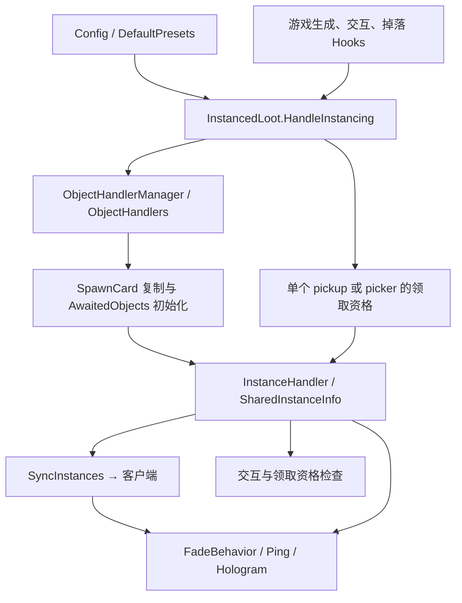

# 架构与数据流

## 系统模型

本项目通过 BepInEx 加载，用 `On.RoR2.*` 和 `IL.RoR2.*` 钩子接入游戏运行时。没有自有场景、服务器进程或持久化数据库；持久配置由 BepInEx 管理，局内状态主要挂在 Unity GameObject 上。



`InstanceMode` 表达“用户希望怎样分配”；`ObjectInstanceMode` 表达“这个对象怎样实现”。前者的 `InstanceItems` 不意味着复制多个可见模型，而通常意味着一个拾取对象服务多个玩家，各有一次领取资格。

## 插件生命周期

源码入口：[InstancedLoot.cs](../InstancedLoot/InstancedLoot.cs)。

1. `Awake`：创建 `Config`、`HookManager`、`ObjectHandlerManager`；ObjectHandler 的 `Init` 可向 HookManager 补充专用钩子；注册 `SyncInstances` 消息类型。
2. `OnEnable`：设置静态 `Instance`，订阅玩家加入事件，安装已登记的钩子。
3. `Start`：触发静态事件 `PreConfigInit`，再执行 `ModConfig.Init()`，生成配置项和预设。外部集成可以在该事件中扩展配置。
4. `OnPlayerAdded`：仅服务器处理；遍历现有实例组，去重后向加入玩家发送状态。它同步已有实例，不会为迟加入玩家自动重建所有交互物副本。
5. `OnDisable`：清空当前单例、卸载钩子、取消玩家事件，调用 HookEndpointManager 清理，并销毁现有 `InstancedLootBehaviour` 组件。卸载有已知疑点，见 [问题记录](KNOWN_ISSUES.md)。

`HookManager.RegisterHandler<T>` 按类型去重；`ObjectHandlerManager.RegisterHandler<T>` 建立类型实例和 `objectType → handler` 映射，后者会覆盖相同 key。二者注册处理器并不等于立即安装 Hook，实际安装在 `RegisterHooks`。

## 核心状态

| 类型/字段 | 职责与约束 |
| --- | --- |
| `InstanceInfoTracker.Info` | 掉落来源：`ObjectType`、`Owner`、`SourceItemIndex`、`PlayerOverride`。用于将上游来源传到最终拾取物，不是网络消息本身 |
| `InstanceOverrideInfo.AttachTo` | 已有 Tracker 时只补空的 ObjectType、PlayerOverride、SourceItemIndex；不会覆盖或补写已有 Tracker 的 Owner。拥有者更新用 `SetOwner` |
| `InstanceHandler.Players` | 当前实例仍有资格交互/领取的玩家集合 |
| `InstanceHandler.OrigPlayer` | `CopyObject` 模式中副本最初分配的玩家，用于区分重叠副本 |
| `SharedInstanceInfo.LinkedHandlers` | 同一实例组中的各个 Handler；共享拾取物通常只有一个 |
| `SharedInstanceInfo.AllPlayers` | 关联实例的 Players 并集；不等于整局玩家列表 |
| `SharedInstanceInfo.AllOrigPlayers` | 关联副本最初归属的玩家并集 |
| `SharedInstanceInfo.SourceObject` | 复制源；同步时可用于恢复位置、旋转和缩放 |
| `SpawnCardTracker` | 记住实际生成该对象的 SpawnCard，供复制使用 |
| `CreatePickupInfoTracker` | 保存 `CreatePickupInfo`，供放弃领取时重建公开掉落 |
| `InstancedLootBehaviour` | 空基类，用于插件卸载时统一发现并销毁附加组件 |

设置 `SharedInfo` 会维护组成员和聚合集合。修改 Players 通常走 `SetPlayers` / `AddPlayer` / `RemovePlayer` → `SyncPlayers` → 重算并同步。初始化阶段可使用 `sync: false`，然后统一完成组装与同步。

## 交互物复制流程

以普通箱子为例：

1. `SpawnCardHandler.DoSpawn` 在生成结果上附加 `SpawnCardTracker`。
2. `ChestBehaviorHandler.Start` 在服务器先检查 `ObjectHandlerManager.HandleAwaitedObject`。若是等待初始化的复制体，由处理器接管并直接返回。
3. 普通对象执行原 `Start`，按名称前缀识别 `ObjectType`，进入 `HandleInstancing`。
4. `HandleInstancing` 合并来源参数、查询最终配置、判断对象/物品分支和 owner-only，并附加来源信息；对象实例化还要经过 `CanInstanceObject`。
5. `AbstractObjectHandler.InstanceObject` 创建共享状态，将源对象分配给首个玩家；`CopyObject` 为其余玩家用 SpawnCard 生成副本。
6. 副本进入 `AwaitedObjects` 和该处理器的 `InfoForAwaitedObjects`。后续 `Start` 回调复制源状态，挂接 `InstanceHandler` 与同一个 `SharedInfo`。
7. 该来源的等待项清空后 `FinalizeObject` 同步整个组，刷新显示。

具体处理器负责复制 RNG、物品和数量；基类在初始化副本时统一通过 `PurchaseInteraction.NetworkcostType`、`Networkcost` 复制源对象最终成本，并为购买 RNG 建立独立副本。价格仍通过游戏原生 SyncVar 同步，不加入 `SyncInstances` 消息，也不持续绑定各副本后续价格。多重商店还需要创建和关联终端：控制器副本共享一组状态，每个三选一终端按位置建立独立的源/副本组，并复制 `ShopTerminalBehavior` 的商品、隐藏和 RNG 状态。源终端只属于源控制器的首位玩家，避免客户端候选同时选中源终端和该玩家的复制终端。`CopyObject` 的交互资格统一由 `InstanceHandler.OrigPlayer` 判定，即使源对象的 `Players` 聚合集合暂时包含全员；`InstancedObject` 和共享领取状态仍按各 Handler 的 `Players` 集合判定。不能只克隆主对象就认为商店逻辑完整。

服务器购买入口再次检查 `PurchaseInteraction.available` 和当前 `InstanceHandler` 资格后才调用原生扣款/关闭逻辑。入口以 `SharedInfo` 作为同帧购买锁；原生购买成功后，服务器原子关闭购买者在该组中的对象。三选一终端还按所属 `MultiShopController` 关闭购买者的全部终端，同时保留其他玩家的合法副本。客户端在 `SyncInstances` 尚未解析完成时保持提示禁用。可选的 `Debug/LogInstanceInteractions` 记录购买状态，默认关闭。

价格复制不能只依赖 SpawnCard：本机更新后的游戏程序集 build `25921972` 中，`PurchaseInteraction.Awake` 仅在开关启用时缩放价格，`Start` 只缓存解锁过滤器；`SceneDirector.PopulateScene` 在 SpawnCard 生成之后另为金币交互物设置难度成本。模组副本绕过 SceneDirector，因此必须复制已初始化源对象的成本。该依据解释 CopyObject 路径的客户端低价，并不证明 issue #5 所报 InstanceItems 情形有同一根因；双端行为仍需验证。

复制优先使用 Tracker 保存的 SpawnCard；否则扫描已加载的 `InteractableSpawnCard` 并按去除 `(Clone)` / 历史 `(Cloned)` 后的 prefab 名寻找。找不到会记录 `Failed to find spawn card ...`。

复制请求必须带非空 `DirectorPlacementRule`：更新后的 `InteractableSpawnCard.Spawn` 会读取 `placementRule.placementMode`，即使位置和旋转已直接传给 `DoSpawn`。复制路径使用 `DirectWithoutRandomRotation`，规则和调用参数均使用源对象位置/旋转，避免原生随机旋转；SpawnCard 完成后仍恢复源对象完整 transform。旧的 null 规则会在新版生成副本时抛异常，构建和仅测价格赋值无法发现该问题。

## 掉落与领取流程

典型链路：

```text
PurchaseInteraction.OnInteractionBegin → SetOwner
ChestBehavior.ItemDrop（或其他来源 Hook）
  → 临时设置 PickupDropletControllerHandler.InstanceOverrideInfo
  → CreatePickupDroplet 的 IL 注入把来源附加到 droplet
  → CreatePickup 将来源传到 GenericPickupControllerHandler（覆盖碰撞与强制初始化路径）
  → CreatePickup 的 IL 注入附加来源与 CreatePickupInfoTracker
  → GenericPickupController.Start → HandleInstancing(isObject: false)
  → InstanceHandler 记录可领取玩家
  → AttemptGrant 前置资格校验；成功授予后移除玩家，还有资格时修改原生 GrantContext.shouldDestroy
```

调用 `HandleInstancing` 的 droplet 阶段主要传递信息；并非所有中间对象都会得到独立领取 Handler。最终普通拾取物要有有效 `itemIndex` 才进入物品实例化分支，装备交换不在此实现范围。

指挥精华的 `CreateCommandCube` 在原生 `NetworkServer.Spawn(GameObject)` 后传递来源。注入必须让直接跳到 Spawn 的分支先经过新增的 `dup`，否则 Spawn 消费唯一的 GameObject 后，回调参数栈为空，安装 Hook 就会抛 `InvalidProgramException`。`CommandCubeIL` 显式接管 incoming labels，并验证唯一的静态单参数 void Spawn 签名。当前真实方法的 `maxOptionCount` 条件分支会触发这个历史缺陷；不能仅检查存在 Spawn 调用。

`PickupGrantPolicy` 将前置资格判断和成功后的资格更新分离。只有原生 `GrantContext.shouldDestroy=true`（已消费）时才移除领取者；还有玩家资格时把 context 改为 false，供原生 consumed 与最终 Destroy 两处读取。旧实际游戏 DLL build `21587608` 与更新后的 `25921972` 均有两次读取，旧实现只改第一处读出的值，不能阻止第二处销毁；新 DLL 已通过生产 emitter 的静态结构检查，游戏内执行仍须验证。临时来源通过 `try/finally` 恢复旧值，避免 droplet、选择器或轮盘的嵌套/异常调用污染后续输出。

`InstanceItems` 使用有效玩家集合；`InstanceBoth` 与 `InstanceItemForOwnerOnly` 的物品分支使用拥有者。显式 `PlayerOverride` 优先于拥有者和全员集合。有效玩家目前直接来自 `PlayerCharacterMasterController.instances`，没有额外的断线/存活过滤。

`PickupPickerController` 处理指挥精华、虚空选择物等：在 `Awake` 后等一帧调用实例化，以便来源信息先到达；替换特定的 `DestroySelf` 事件，在仍有玩家资格时保留对象。

- `SharePickupPickers=false`：每位玩家可分别选择；输出只指定当前选择者。
- `SharePickupPickers=true`：一位玩家选择后，把所有剩余玩家写入输出的 `PlayerOverride`；选择器资格清空，输出供这些玩家分别领取。

这些路径应与配置优先级、普通掉落和指挥神器转换一起核对。箱子自身后来也带 `PickupPickerController`，现有 `isObject` 参数是相关历史兼容修补的一部分。

build `25921972` 还有 `PickupPickerController.AttemptGrantPickupDirectly(UniquePickup)`：正常分支直接通过 ItemTransferOrb 或 PickupDef 授予，不进入上述 CreatePickup/普通 pickup 授予路径。当前未 Hook 该方法，也未核对调用它的 prefab/事件资产；其共享选择语义尚未验证，不能从 CreatePickup 路径推断。

## 网络协议

实现：[SyncInstances.cs](../InstancedLoot/Networking/SyncInstances.cs)，使用 R2API 的 `INetMessage` 和 Unity Networking 的对象 ID。

主路径是服务器通过 `SharedInstanceInfo.SyncToAll/SyncTo` 发消息。客户端 `OnReceived` 启动协程；服务器收到该消息时直接忽略。消息序列化顺序如下：

```text
ObjectInstanceMode(int)
SourceObject(NetworkInstanceId，允许 Invalid)
条目数(int)
每条：target ID → origPlayer ID → 玩家数(int) → players ID 列表
```

客户端等待所有 target、player、非 Invalid 的 source 都可解析，并检查玩家组件存在；每轮重新解析，避免另一条引用等待期间已解析对象被销毁。等待按实时计时最多 30 秒，不再受 40 帧阈值限制。较晚收到的同组快照会取消仍在等待的旧快照，避免旧协程稍后恢复已领取资格；这仅按本地接收顺序处理，不提供传输层乱序检测或新增协议版本号。成功后创建/复用各目标的 `InstanceHandler`，设置玩家与原拥有者（包括清空）、重建共享组和显示。

切换 Run、插件失效或卸载时取消等待；卸载时同步清空 pending，防止同一帧重启后复活旧任务。超时记录来源和目标 ID，`FailedSyncs` 最多保留 32 组诊断条目，没有后台重放实现；同一 Run 内换关可能仍等到超时。`InstanceHandler.OnDestroy` 会从共享组移出自身、清空已销毁的来源并重算玩家聚合，防止后续快照引用已销毁成员。迟加入仍只补发已有状态，不增加新份额。

此协议只传实例组状态，不同步配置文件，也没有独立的“移除实例化组件”消息。`uninstance` 因此采用重新生成公开 droplet 的临时方案，而不是直接让现有组件在两端消失。

## 权限与视觉

- `PurchaseInteractionHandler`、`GenericPickupControllerHandler`、`PickupPickerControllerHandler` 检查实例资格；购买路径在服务器调用原 `OnInteractionBegin` 扣款和购买事件之前再次校验资格，防止直接调用绕过提示判断。`CopyObject` 使用 `OrigPlayer`，`InstancedObject`/共享领取状态使用 `Players`。普通拾取物还通过 `OnTriggerStay` 阻止无资格自动拾取。
- `InteractorHandler` 在客户端 `FindBestInteractableObject` 的重叠候选筛选阶段检查实例资格；它通过交互者所在 `CharacterBody` 的 master 找到 `PlayerCharacterMasterController`，让重叠箱子优先保留当前玩家有资格使用的副本。
- `FadeBehavior` 监听 SceneCamera 的 PreCull/PreRender，按相机目标玩家隐藏其他副本，或设置 `_Fade`（默认淡化值 `0.3`）。它维护 Renderer、DitherModel、灯光、高亮及额外效果对象列表。
- `DitherModelHandler` 对原生淡化值叠加实例可见性；不支持相关 shader 的材质仍可能显示异常。
- Dither 可见性每次按当前相机目标玩家查当前资格，避免同一玩家领取后仍复用旧值；组件销毁恢复 renderer 和淡化状态，分屏仍分别查询各相机。
- `HologramProjectorHandler` 过滤价格提示的观察者，并在模型变化后刷新显示列表；月球舱的文本依赖下一帧刷新。
- `PingHandler` 调整标记文本、可用性和 UI 位置提示；`PingerControllerRenderBehaviour` 按相机玩家隐藏标记，但其中实际高亮目标赋值已被注释，不能宣称完整重定向已实现。
- `AnimationEventsHandler` 通过 `AnimationPrefabIL` 在 CreatePrefab 内 4 个 DoSpawnEffect 返回点取得 Transform、当前 AnimationEvents 和 pool flag；保留原 Transform，仅将非池化对象纳入对应 FadeBehavior。池化对象可能跨拥有者复用，尚无租借/归还时的安全显示关联。`EffectManagerHandler` 仍只覆盖 SpawnEffect 的 Instantiate 路径，效果系统未全部覆盖。
